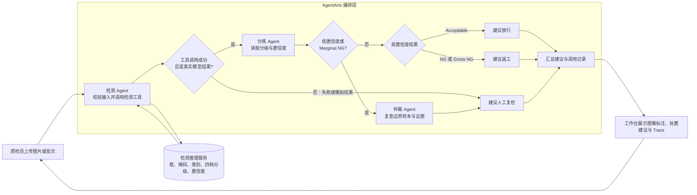

# 毫芒 Hairline｜技术方案

更新：2026-10-13。此文件只保留实现约定；待验证项在代码落地时更新。

## 架构

`图片/批次 → 推理服务 → AgentArts 检测 → 分流 → 边界仲裁 → 工作台/工单`

评测脚本独立运行，不使用 Agent 的文字结论算指标。若希望在重模型前粗筛，应为粗筛单独提供输出；目前的模拟接口只返回检测后的置信度，因此现阶段只能**先检测、后分流**。

### Agent 设计与工作流程（待在 AgentArts 实现）

| 角色 | 输入 | 动作 | 输出 |
|---|---|---|---|
| 检测 Agent | 图片地址、样本 ID | 调用推理服务，检查返回字段与运行模式 | 缺陷位置、类别、四档分级、置信度；或错误状态 |
| 分拣 Agent | 检测结果 | 按已记录的阈值与档位选择路径 | 常规处置或送仲裁的理由 |
| 仲裁 Agent | 边界档或低置信度结果及视觉证据 | 整理不确定性和复核要点 | 人工复检建议，不伪造确定结论 |

这里的“放行/返工”是**建议**，不直接控制产线。阈值需要在验证数据上校准并记录版本；当前未校准。模拟接口返回 `demo_only=true`，只能演示调用链，不能进入真实处置或评测。AgentArts 公测尚未开通，因此图示是待实现设计，不是已运行的系统。

| 目录 | 职责 |
|---|---|
| `src/` | 预处理、模型推理、后处理及 HTTP 服务 |
| `agentarts/` | 平台工具接入和编排说明 |
| `eval/` | 指标与实验对比脚本 |
| `data/raw/`、`data/processed/` | 只读原始数据、派生数据；均不进 Git |
| `runs/` | 配置、指标、日志及模型输出；不进 Git |

## 推理接口 v0

现有模拟实现：`POST /v1/inspect`，请求 `{"image_url":"...","sample_id":"可选"}`；响应包含 `sample_id`、`mode`、`demo_only`、`image_analyzed`、`image_size`、`grade`、`confidence`、`defects`。缺陷项包含 `category`、`confidence`、`bbox_xyxy`、`severity`。坐标基于原图像素，顺序左上右下。完整示例见 [`agentarts/README.md`](../agentarts/README.md)。

模拟服务的 `mode=mock`、`demo_only=true`、`image_analyzed=false`；它不读取 `image_url`。真实服务必须实际分析图片、标明模型版本，并经接口核验后才能改为 `mode=model`。演示数据不得进入评测。

AgentArts 在云端访问服务时，需部署到其可访问的 HTTPS 地址；本地 `127.0.0.1` 仅用于开发。插件格式、鉴权和平台限额以登录后的实际页面核对。

## 算法和评测顺序

1. **数据到手前**：确认 GPU；clone 官方 baseline；在许可允许的公开数据上跑通定位训练或推理，并报出该数据集的 mIoU。MVTec-AD 没有四档分级标签，不能计算 ICME 口径的 QWK。
2. **数据到手后**：先核对许可、划分、标签和官方评测脚本，再复现 YOLOv8-seg + 规则分级的官方 baseline。
3. **改进**：一次只改一个变量，例如分级规则改为 CORN/CORAL 序数头，或改进定位骨干/分辨率；每次记录 mIoU、Macro-F1、QWK、总分和错误样本。
4. **比较**：仅在同一数据、划分和评测公式下比较；保留配置、代码版本和输出。QWK 0.89 可作内部观察阈值，是否接受改动最终看总分与误判代价。

每组实验记录至少包括：数据集与划分、模型与权重、配置、代码提交号、三个指标、总分及输出目录。参考分数不是复现结果。
