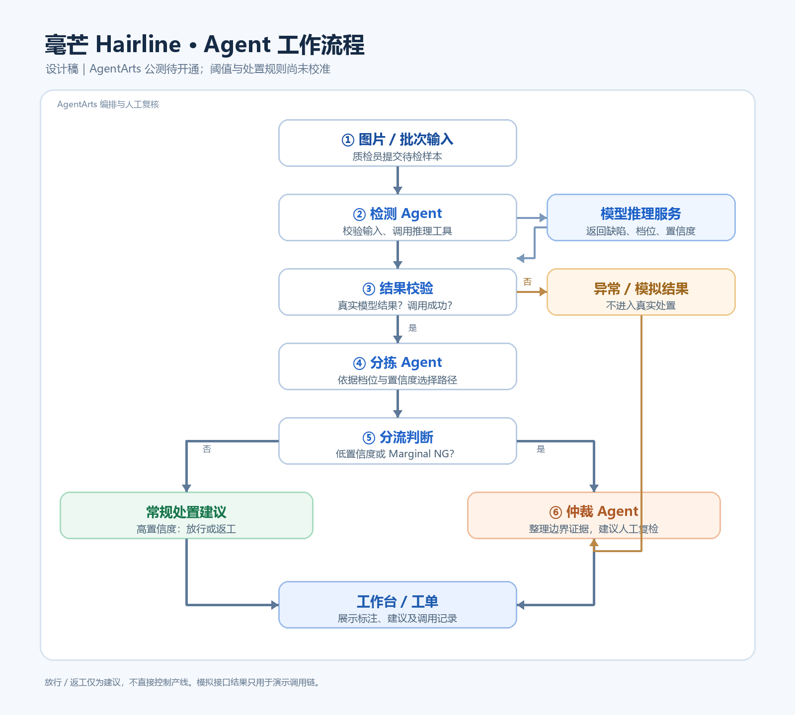

# 毫芒 Hairline｜Agent 工作流程图

> 设计稿：AgentArts 公测尚未开通，下面是待实现流程。

| Agent | 输入 | 关键动作 | 输出 |
|---|---|---|---|
| 检测 | 图片地址、样本 ID | 调用推理服务，检查返回字段与运行模式 | 缺陷与分级结果，或错误状态 |
| 分拣 | 检测结果 | 按档位和置信度选择常规处置或复核 | 分流路径及理由 |
| 仲裁 | 低置信度或边界档结果 | 整理视觉证据和不确定性 | 人工复检建议 |

“放行/返工”只表示建议，不直接控制产线。置信度阈值待真实数据校准。模拟接口返回 `demo_only=true`，只能演示调用链，不能用于实际处置或评测。
